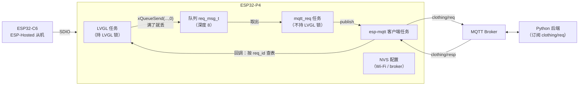

# 智能线下门店交互系统 · ESP32-P4 终端固件

基于 **ESP-IDF + FreeRTOS** 的门店终端主控固件：LVGL 9 触控界面（库存 / 销售 / 盘点 / 搜索 / 设置五页），
通过 MQTT 与 Python 后端完成商品库存的增删改查、销售记录与跨日数据同步。

> 个人项目，2026.03 – 2026.08。本仓库是终端侧固件；Python 后端不在本仓库内。

---

## 硬件

| 部件 | 型号 / 说明 |
|---|---|
| 主控 | ESP32-P4 Function EV Board（双核 RISC-V，16MB Flash + PSRAM） |
| 显示屏 | MIPI-DSI LCD（`esp32_p4_function_ev_board_noglib` BSP） |
| 触摸 | GT911（I2C） |
| 联网 | ESP32-C6 协处理器，经 **ESP-Hosted（SDIO）** 提供 Wi-Fi |

## 软件环境

| 组件 | 版本 |
|---|---|
| ESP-IDF | ≥ 5.5.3 |
| LVGL | 9.4 |
| esp_lvgl_adapter | 0.3 |
| esp_hosted / esp_wifi_remote | `*` / ≥ 1.3.1（P4 无射频，Wi-Fi 协议栈跑在 C6 上） |

## 架构



**核心思路：界面只负责入队，发送由独立任务完成，回调里只更新界面。**

## 关键实现

### 1. 请求-应答协议（12 个 action）

一条 MQTT 消息承载全部业务，靠 `action` 字段分流：

```json
// 请求 → clothing/req
{"action": "query_stock", "req_id": 17, "page": 1, "size": 20}

// 响应 ← clothing/resp
{"action": "query_stock", "req_id": 17, "code": 0, "data": []}
```

- `req_id` 自增保证唯一，发送前把 `{req_id, callback}` 登记进 **8 槽位 pending 表**；
- 响应回来按 `req_id` 查表，命中才回调，查不到直接丢弃（超时 / 过期响应）；
- pending 表被 UI 任务与 MQTT 任务同时访问，用互斥锁保护。

### 2. 大响应分片重组

esp-mqtt 对大 payload 会**分多次回调**（`current_data_offset` / `total_data_len`），
不能直接解析。实现方式：按 `offset` 把分片拷入一整块缓冲，拼满 `total_len` 后再交给 cJSON 解析。

### 3. 队列解耦，消除死锁

初版是「界面回调里直接 publish」，出现了**界面卡死**（详见下节）。改为：

```
点击 → 组包 → xQueueSend（非阻塞，满了直接返回失败）→ LVGL 继续刷屏
                                   ↓
                        mqtt_req 任务 → publish → broker → 回调 → 更新界面
```

LVGL 任务从此不再持有锁去等网络，HTTP/MQTT 的阻塞不再传导到 UI。

### 4. 时钟与跨日

SNTP（`ntp.aliyun.com` / `pool.ntp.org`）校时，每秒刷新界面时间；
销售记录按日期分表，跨日自动切到新的一天。

## 遇到过的问题

### 问题一：界面卡死（死锁）

**现象**：连续点查询，界面停止刷新，但系统不崩溃、不重启，日志也不再输出业务信息。

**定位过程**：现象缩小到「只在有网络请求时卡」→ 检查发现 publish 在 LVGL 回调里同步调用 →
该调用会等待 esp-mqtt 任务排空发送缓冲，而 esp-mqtt 任务此刻正卡在响应回调里申请同一把 LVGL 锁。

```
LVGL 任务：持 LVGL 锁 → publish → 等 MQTT 任务
MQTT 任务：收到响应 → 回调申请 LVGL 锁 → 等 LVGL 任务
```

两边各持一把、各等一把，形成环。

**修复**：发送拆到独立任务 + 队列（见「关键实现 3」）；同时给界面请求加"同一时刻只保留最新一条"的取消逻辑，避免旧响应覆盖新数据。

**验证**：连续快速点击查询 / 断网后重连再点，界面均不再卡死；日志中 `req_id` 交叉但每次回调都对得上。

### 问题二：大响应解析失败

商品列表超过单次接收长度时，直接 `cJSON_Parse` 会失败（JSON 被截断）。
改为按 `total_data_len` 重组后再解析，并把接收缓冲调到 4096 减少分片次数。

## 目录结构

```
main/
├── main.c                 入口：初始化 NVS / 显示 / LVGL / 网络
├── adapter/               LVGL 与 esp_lvgl_adapter 的对接
├── bsp/                   显示、触摸、SD 卡
├── config/                app_config.h + 敏感配置模板
├── network/               mqtt.c（协议与 pending 表）、wifi_hosted.c
└── ui/
    ├── custom/            业务页面逻辑（custom.c）
    └── generated/         GUI Guider 生成的界面与字体
docs/design-notes.md       设计与踩坑记录
```

## 编译与运行

```bash
# 1. 准备敏感配置
cp main/config/app_config_private.h.example main/config/app_config_private.h
#    编辑，填入你的 Wi-Fi SSID / 密码（MQTT 用公共 broker 时保持默认即可）

# 2. 编译烧录
idf.py set-target esp32p4
idf.py build
idf.py -p <PORT> flash monitor
```

## 演示

<!-- 插入 2-3 张实机截图 + 一段操作视频链接 -->

- 截图：库存页 / 销售记录页 / 断网重连
- 视频：待补充

## 说明

- 项目为 2 人协作：本人负责 ESP32-P4 固件（LVGL 业务层、MQTT 协议、死锁与分片问题的定位修复）；Python 后端与 LVGL 界面移植由队友完成。
- 仓库不含 `app_config_private.h`（Wi-Fi 与 broker 凭证），请按上面的步骤自行生成。
